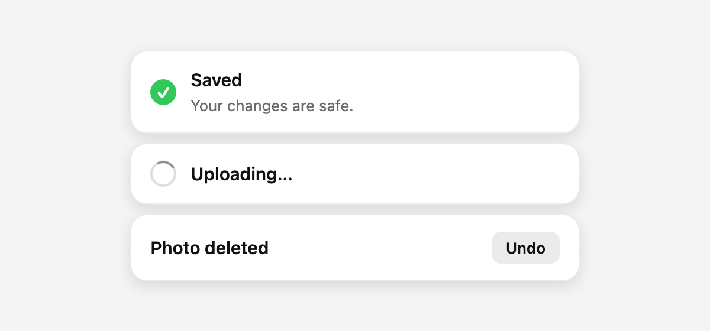

<p align="center">
  
</p>

<h1 align="center">Crispy Toast</h1>

<p align="center">
  One toast API for every platform.
</p>

<p align="center">
  <a href="https://www.npmjs.com/package/crispy-toast"></a>
  <a href="https://github.com/rudysides/crispy-toast/actions/workflows/ci.yml"></a>
  <a href="LICENSE"></a>
  
  
</p>

<p align="center">
  
  
  
  
  
  
</p>

<br />

Write a toast once and show it on **iOS, Android, web, macOS and Windows**.

Zero runtime dependencies, no native code (works in Expo Go).

| Import             | Use it in                        | Renders with                                                        |
| ------------------ | -------------------------------- | ------------------------------------------------------------------- |
| `crispy-toast`     | React Native / Expo              | `View`, `Text`, `Animated` (iOS, Android, macOS, Windows, Expo web) |
| `crispy-toast/web` | Next.js, Vite, any React DOM app | HTML and CSS                                                        |

## Install

### Expo / React Native

```sh
npx expo install crispy-toast
```

Requires the peer dependency `react-native-safe-area-context`, which every Expo template already includes. If your app doesn't have it, run `npx expo install react-native-safe-area-context`.

### Next.js / Vite

```sh
npm i crispy-toast
```

No stylesheet import is required; `<Toaster />` includes its own styles.

### React Native macOS / Windows

```sh
npm i crispy-toast
```

## Usage

Render `<Toaster />` once at the root of your app, then call `toast()` from anywhere.

```tsx
// Expo / React Native
import { Toaster, toast } from "crispy-toast";

// Next.js / Vite
import { Toaster, toast } from "crispy-toast/web";

export default function App() {
  return (
    <>
      <YourApp />
      <Toaster position="bottom-center" />
    </>
  );
}

toast("Hello!");
toast.success("Saved", { description: "Your changes are safe." });
toast.error("Something went wrong");
toast.warning("Battery is low");
toast.info("New version available");
```

In the Next.js App Router, put `<Toaster />` in your root `layout.tsx`. The web entry is already marked `"use client"`.

<p align="center">
  <picture>
    <source media="(prefers-color-scheme: dark)" srcset="docs/screenshots/hero-dark.png" />
    
  </picture>
</p>

### Update and dismiss

```ts
// Same id = update the existing toast instead of adding a new one.
toast("Uploading…", { id: "upload", duration: Infinity });
toast.success("Uploaded", { id: "upload" });

toast.dismiss("upload"); // one toast
toast.dismiss(); // all toasts
```

### Loading and promises

```ts
toast.loading("Saving…"); // spinner, stays until updated or dismissed

// Loading → success or error. Returns the same promise, so you can still await it.
toast.promise(saveSettings(), {
  loading: "Saving…",
  success: "Saved",
  error: (error) => `Could not save: ${error}`,
});
```

`success` and `error` can be strings or functions that receive the resolved value or the error.

### Actions

```ts
toast("Photo deleted", {
  action: { label: "Undo", onPress: () => restorePhoto() },
});
```

Pressing the action calls `onPress` and dismisses the toast. The toast's own `onPress` is not called.

### Pausing and keyboard

The timer pauses while the pointer is over a toast (web, macOS, Windows) and, on the web, while it has keyboard focus. On the web, toasts can be reached with Tab: Enter or Space presses the toast and Escape dismisses it.

## API

### `toast(message, options?)`

Also available as `toast.success`, `toast.error`, `toast.warning`, `toast.info` and `toast.loading`. Returns the toast id.

| Option        | Type                         | Description                                                       |
| ------------- | ---------------------------- | ----------------------------------------------------------------- |
| `id`          | `string`                     | Reuse an id to update an existing toast.                          |
| `description` | `string`                     | Secondary text below the message.                                 |
| `icon`        | component, element or `null` | Replaces the built-in icon. `null` hides it. See [Icons](#icons). |
| `duration`    | `number`                     | Milliseconds. `Infinity` keeps the toast until dismissed.         |
| `style`       | style object                 | `StyleProp<ViewStyle>` on native, `CSSProperties` on web.         |
| `action`      | `{ label, onPress }`         | A button inside the toast. Pressing it dismisses the toast.       |
| `onPress`     | `() => void`                 | Called when the toast is tapped. Tapping always dismisses it.     |
| `onDismiss`   | `() => void`                 | Called when the toast closes, for any reason.                     |

### `<Toaster />`

| Prop            | Default           | Description                                                                             |
| --------------- | ----------------- | --------------------------------------------------------------------------------------- |
| `position`      | `"bottom-center"` | `top-left`, `top-center`, `top-right`, `bottom-left`, `bottom-center`, `bottom-right`   |
| `duration`      | `4000`            | Default duration in milliseconds.                                                       |
| `visibleToasts` | `3`               | How many toasts are shown at once.                                                      |
| `offset`        | `16`              | Distance from the safe area edge.                                                       |
| `theme`         | `"system"`        | `light`, `dark` or `system`.                                                            |
| `colors`        | —                 | Override any theme color (see below).                                                   |
| `icons`         | —                 | Replace the built-in icon per type, e.g. `{ success: CheckIcon }`. See [Icons](#icons). |
| `textStyle`     | —                 | Applied to every text, e.g. `{ fontFamily: "Inter" }`.                                  |
| `toastStyle`    | —                 | Applied to every toast.                                                                 |

On phones a toast spans the screen width, so left, center and right look the same. The difference shows on tablets and the web.

### Icons

Use any icon: your own SVG component or one from an icon library. crispy-toast adds no icon dependency.

```tsx
import { Check, X } from "lucide-react"; // or lucide-react-native, @expo/vector-icons, …

toast.success("Saved", { icon: Check }); // component
toast("Uploaded", { icon: <MarkIcon width={18} /> }); // element, rendered as-is
toast.error("Failed", { icon: null }); // no icon

<Toaster icons={{ success: Check, error: X }} />; // app-wide
```

A component receives `size` (20) and `color` (the toast type's color, or `text` for plain toasts), which most icon libraries understand. On the web `color` is `currentColor`. An element gets neither, so set its size and color yourself. A toast's own `icon` overrides `<Toaster icons>`, which overrides the built-in icon.

## Styling

Most apps only need `theme` and a couple of `colors`:

```tsx
<Toaster
  theme="dark"
  colors={{ background: "#4F46E5", text: "#FFFFFF" }}
  textStyle={{ fontFamily: "Inter" }}
/>
```

| Color                                            | Used for                      |
| ------------------------------------------------ | ----------------------------- |
| `background`                                     | Toast background              |
| `text`                                           | Titles and action button text |
| `muted`                                          | Descriptions                  |
| `border`                                         | Toast border, action button   |
| `success`, `error`, `warning`, `info`, `loading` | Icon colors                   |

For anything else, use `toastStyle` or a per-toast `style`. Styles are applied in this order, and the last one wins: defaults → theme → `colors` → `<Toaster>` props → per-toast `style`.

**Web only:** every color is also a CSS variable (`--ct-background`, `--ct-text`, …). Every built-in selector has zero specificity, so your own CSS always wins:

```css
[data-crispy-toaster] {
  --ct-background: black;
}
[data-crispy-toast] {
  border-radius: 4px;
}
```

**NativeWind / Uniwind:** the style props are flat, so you can map class names onto them, e.g. `remapProps(Toaster, { toastClassName: "toastStyle" })` in NativeWind v4.

## Development

```sh
pnpm install
pnpm test        # unit tests (store, timer, icons) and web component tests
pnpm lint        # oxlint
pnpm format      # oxfmt
pnpm build       # compile to dist/
pnpm dev         # compile in watch mode
```

The `examples/` folder contains demo apps for Expo, macOS, Windows, Vite and Next.js. The local ones use the built `dist/`, so keep `pnpm dev` running while you work:

```sh
pnpm --filter crispy-toast-example-expo ios      # or android, web
pnpm --filter crispy-toast-example-macos macos
pnpm --filter crispy-toast-example-vite dev
pnpm --filter crispy-toast-example-next dev
```

The README images come from the Vite example: open it with `?screenshot=light` or `?screenshot=dark`.

`examples/windows` is built only in CI, because react-native-windows needs Visual Studio. Run the workflow with `gh workflow run windows.yml` and download the screenshot of the running app with `gh run download -n windows-screenshot -D windows-screenshot`.

## License

MIT
